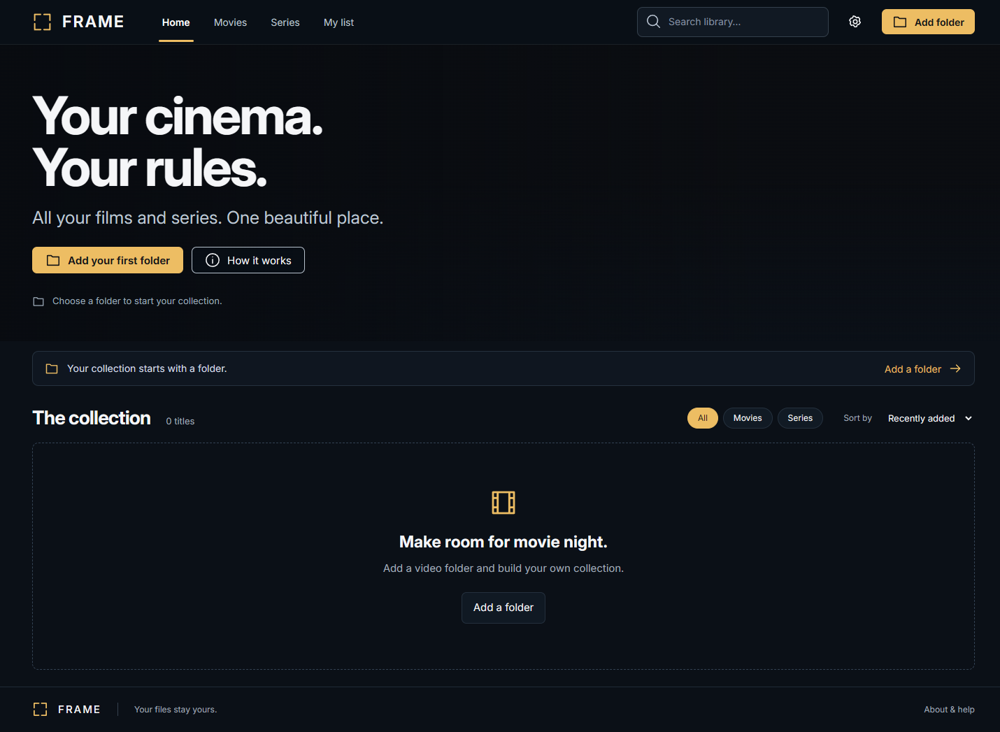

# FRAME

A local cinema for the videos already on your computer. **Free to download and
use for personal, noncommercial purposes.**

FRAME is a single HTML file with embedded JavaScript, CSS and Inter font. Open it
in a desktop browser, select your video folders, and browse films and series with
artwork, summaries, cast photographs, watchlists and resume playback.



## Download and run

**[Download FRAME.html](https://github.com/vinaysheelrao/FRAME/releases/latest/download/FRAME.html)**
or get the [personal-use ZIP and release notes](https://github.com/vinaysheelrao/FRAME/releases/latest).

1. Download **FRAME.html** from this repository's Releases. You
   can also use **Code → Download ZIP**, extract it, and open the root `FRAME.html`.
   Download the actual file; GitHub's source preview does not run the app.
2. Open it in desktop Chrome or Edge. No installation, server or build is needed.
3. Click **Add folder**, or choose **About & help → Add individual files**.
4. In Settings, select a metadata source. Supply **your own** TMDB API key or API
   Read Access Token for films and series, use TVmaze for series without a key,
   or choose Offline for manual details. Accept the provider's applicable terms.
5. Use **Auto-match library** to fill missing details, then select a title to play.

No API key, films, television episodes, posters, personal library or reference
page archives are included. All library data starts empty.

## Features

- Read-only scans of selected folders and subfolders; files stay where they are.
- Filename cleanup and ranked automatic matching using title variants, year,
  media type and series/episode markers. Uncertain matches can be reviewed.
- Series grouped into a single entry with a season picker and episode list.
- Posters, synopsis, genres, rating, cast names, characters and actor photographs
  when the metadata provider has them.
- Recently played artwork in the banner, then recently added artwork.
- Search, filters, watchlist, watched status and playback progress.
- Windowed/fullscreen playback, 10-second left/right seeking and SRT/VTT subtitles.
- Nearby subtitle discovery with supported folder access; a manual picker fallback.
- Source file location copying and a separately labelled **Save copy** action.
- Local browser storage and JSON backup/import. TMDB content is excluded from
  backups; file information, progress and match IDs remain available.
- Embedded Inter and slim, rounded controls that match the dark interface.

Matching is deterministic string scoring, not an ML model. Scores are ranking
evidence, not calibrated probabilities. IMDb, JustWatch and web-search buttons
open normal search pages; FRAME does not scrape them or automatically read them.

## Metadata providers

| Source | Use | Requirements |
| --- | --- | --- |
| TMDB | Films, series, cast and images | Your own credential and compliance with TMDB terms |
| TVmaze | Series, cast and images | No key for the public API; attribution and CC BY-SA obligations |
| Offline/manual | Your own details and selected artwork | No metadata search requests |

Get a credential from [TMDB account settings](https://www.themoviedb.org/settings/api).
Read the [TMDB API terms](https://www.themoviedb.org/api-terms-of-use),
[attribution requirements](https://developer.themoviedb.org/docs/faq) and
[TVmaze API documentation](https://www.tvmaze.com/api).

This product uses the TMDB API but is not endorsed or certified by TMDB.
This application uses TMDB and the TMDB APIs but is not endorsed, certified, or
otherwise approved by TMDB. TVmaze data is credited in title details and exports;
selected fields are normalized and summary markup is converted to text.

## Browser limits and troubleshooting

- Remembered folder access depends on the browser and permissions. If playback
  needs reconnection, select the original video or folder in the reconnect dialog.
- MP4 with H.264/AAC and WebM commonly work. Recognizing a file extension does not
  mean the browser can decode its video/audio. No transcoder is included.
- **File location** cannot launch a desktop player. Browsers do not reveal full
  disk paths: enter the library root once to compose and copy a path, then open
  it in your player. **Save copy** downloads another copy.
- Subtitle browsing starts in the video folder only when directory handles and
  the relevant picker API are available. Otherwise the browser chooses the folder.
- Browser storage can be cleared or evicted. Export backups regularly. Keep the
  HTML at the same location and use the same browser profile when updating it.
- Internet is required for metadata and uncached remote images. Choosing Offline
  disables metadata lookups; existing remote image URLs may still load. For fully
  disconnected use, disconnect networking and rely on cached/local artwork.
- TMDB metadata and cached images expire after 150 days. Expiry runs at startup
  and while the app is active; a closed HTML file cannot perform background work.
  Unknown-age imported TMDB data is discarded. Run Auto-match with your credential
  to refresh known IDs. Private backups omit TMDB-derived content, including
  edits to those entries; other manual entries and TVmaze credits are retained.
- No cloud account, synchronization, DRM bypass, video downloads, automatic disk
  monitoring while closed, or streaming-service access is included.

## Privacy

Videos are not uploaded. Metadata providers receive cleaned title queries and
years, language and request metadata such as your IP address; image hosts receive
image requests. No FRAME analytics, ad service or telemetry is included.

Credentials stay in memory unless **Remember** is checked, which stores them in
browser storage without application-level encryption. Backups exclude credentials
but include filenames, paths, watch history and some provider data. Keep backups
private. See [PRIVACY.md](PRIVACY.md) for storage and deletion details.

## Build and check

Python 3.10+ and Node.js 20+ are development tools only; end users need neither.
The build uses only Python's standard library and makes no network requests.

```sh
python scripts/build.py
python scripts/build.py --check
python -m unittest discover -s tests -p "test_*.py"
node scripts/check-js.cjs
```

Edit `src/frame.html`, not the generated root `FRAME.html`. The build embeds the
font, approved TMDB attribution logo and complete license/privacy notices.
See [DEVELOPMENT.md](docs/DEVELOPMENT.md) for optional browser smoke tests.

## License and credits

The original code and documentation use the custom
[FRAME Personal Noncommercial License 1.0](LICENSE). You may use and modify them
for personal noncommercial purposes and share free copies under the same terms.
Commercial use, resale and monetization are not permitted by this license.
This is **source-available**, not OSI-approved open source.

Inter uses SIL OFL 1.1. TVmaze data remains under CC BY-SA 4.0, with its own
commercial-use permissions; the software's noncommercial restriction does not
extend to it. TMDB branding and data retain their separate terms. See
[THIRD_PARTY_NOTICES.md](THIRD_PARTY_NOTICES.md). The app license grants no rights
to media or provider content. Use media you are entitled to access.

FRAME is independent of Netflix, IMDb, JustWatch, TMDB and TVmaze. No affiliation
or endorsement is implied. The FRAME name has not undergone a trademark search.

## Contributing and publishing

See [CONTRIBUTING.md](CONTRIBUTING.md), [SECURITY.md](SECURITY.md), and the
[publishing guide](docs/PUBLISHING.md). Do not submit API keys, library backups,
real video files or third-party posters in issues or pull requests.

